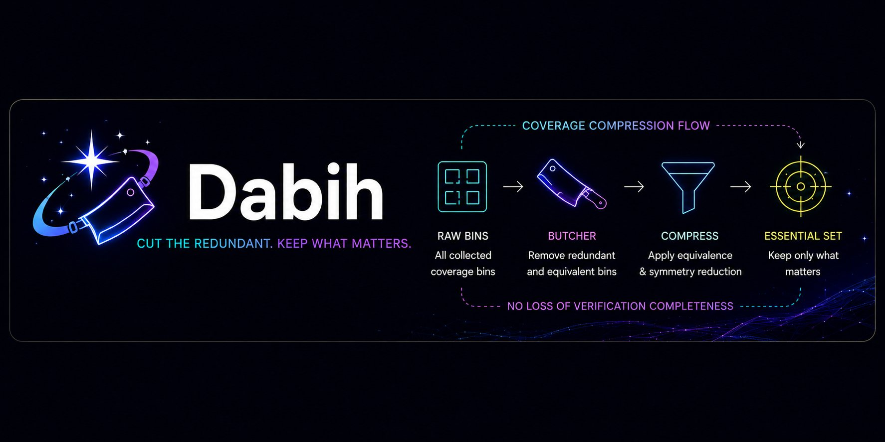

<div align="center">
  
</div>

<br/>

**Coverage-model compression for replicated hardware — ASIC/FPGA verification.**

In a design built from identical lanes, channels or pipeline stages, hitting one bin implies coverage for every symmetric equivalent. Dabih reads the replicated structure from your RTL, partitions the cross-coverage bins into equivalence classes (orbits), and tells you what is actually left to cover. An 8-lane × 4-state cross of **65,536 bins collapses to 165 equivalence classes — 397× fewer**. It runs as a CLI and as a Python library, and can emit formal properties to check the symmetry claim itself.

---

## Overview

```
RTL source (.sv)
      │
      ▼
 dabih scan / spec     ← pyslang generate-for extraction (no elaboration)
      │                   orbit partition via Pólya / Burnside counting
      ▼
   spec.json           ← compressed coverage model
      │
      ├────────────────▶ dabih verify    ← SpyGlass + Questa Formal artifacts that
      │                                    check the symmetry claim is sound
      │
simulation results  (Dabih JSON · Questa vcover report · VCS urg report)
      │
      ▼
 dabih expand          ← orbit expansion, hole list, provenance (fragile orbits)
 dabih report          ← self-contained HTML sign-off report
```

---

## Quick Start

### Install

Requires Python 3.11+.

```bash
cd dabih
pip install -e ".[dev]"      # installs pyslang, pytest, build and the `dabih` command
dabih --help
```

### Try it on the bundled examples

Run from the repository root:

```bash
# 1. See what Dabih extracts from the RTL
dabih scan examples/rtl/serdes_top.sv --param N_LANES=4

# 2. Build the compressed coverage model
dabih spec examples/rtl/serdes_top.sv --param N_LANES=4 \
    --cover rx_lane state IDLE ACTIVE STALL ERROR \
    --module rx_lane --out spec.json
#   ✓ serdes_top.rx_lane × 4  →  35 orbits / 256 bins  (7.3×  polya)

# 3. Expand three simulation runs, merged, with provenance
dabih expand examples/results/*.json --spec spec.json --provenance
#   exit code 1 = coverage incomplete (use it as a CI gate; --no-exit-code to suppress)

# 4. Or read a simulator report directly — no testbench changes
dabih expand --questa-report examples/simulator/questa_4lane_partial.txt \
    --covergroup rx_lane_cross_cg --spec spec.json

# 5. Generate the HTML report
dabih report examples/results/*.json --spec spec.json --out report.html --provenance

# 6. Emit formal artifacts for the symmetry claim
dabih verify --spec spec.json --dut serdes_top --inst "rx_gen[{i}].u_rx" \
    --clk clk --input valid data --output state ready \
    --rtl examples/rtl/serdes_top.sv --out-dir formal/
```

Pre-generated outputs from these commands are checked in under `examples/specs/`, `examples/reports/` and `examples/formal/`. The 4-lane example compresses 7.3×; compression grows quickly with lane count — try `--param N_LANES=8` for 165 orbits from 65,536 bins.

---

## Commands

| Command | What it does |
|---|---|
| `dabih scan` | Parse RTL and report the generate-for arrays Dabih detects |
| `dabih spec` | Build the compressed coverage model and write it as spec JSON |
| `dabih expand` | Expand simulation results against a spec; text / JSON / HTML; exit 1 when incomplete |
| `dabih report` | Generate the self-contained HTML sign-off report |
| `dabih verify` | Emit SpyGlass (structural) and Questa Formal (behavioural) artifacts for the symmetry claim |

Coverage input can be Dabih result JSON, a Questa `vcover report -details` text file (`--questa-report`), or a VCS `urg -format text` file (`--vcs-report`). Passing several runs merges them; `--provenance` records which runs covered each orbit.

---

## Documentation

| Document | Audience | Description |
|---|---|---|
| [User Guide](docs/user-guide.md) | Verification engineers | Installation, CLI reference, Python API, typical workflows |
| [Design](docs/design.md) | Developers | Architecture, mathematical foundation, algorithms, data formats |
| [Errata](docs/errata.md) | All | Known limitations, fixed bugs, test-coverage gaps |
| [Schema Changelog](docs/schema-changelog.md) | All | Spec and result JSON format history |
| [Requirements](REQUIREMENTS.md) | Developers | Living requirements and decision record |
| [Releasing](RELEASING.md) | Maintainers | Building and publishing a release |

---

## Project Structure

```
dabih/
├── dabih/                         Python package — the `dabih` CLI and library
│   ├── cli.py                     CLI entry point: scan / spec / expand / report / verify
│   ├── core/
│   │   ├── symmetry.py            Permutation, SymmetryGroup (generator closure)
│   │   ├── coverpoint.py          Coverpoint, BinLabel
│   │   ├── bin_space.py           BinSpace, Orbit — core orbit engine
│   │   ├── symbolic.py            SymbolicOrbitEngine — Pólya / Burnside / Möbius boundary
│   │   └── spec_io.py             BinSpace ↔ spec JSON (contract between CLI commands)
│   ├── rtl/
│   │   ├── generate_array.py      GenerateArray data class
│   │   ├── extractor.py           RtlExtractor — pyslang CST, no elaboration
│   │   └── bridge.py              BinSpaceBuilder — extracted arrays → BinSpace
│   ├── coverage/
│   │   ├── result.py              CoverageResult (portable result JSON)
│   │   ├── expander.py            ExpansionEngine (BFS, ≤ ~1M bins) + provenance
│   │   └── symbolic_expander.py   SymbolicExpansionEngine (large spaces) + provenance
│   ├── adapters/
│   │   ├── questa.py              vcover report text → CoverageResult
│   │   └── vcs.py                 urg text report → CoverageResult
│   ├── formal/
│   │   ├── spec.py                DUTSpec, PortSpec
│   │   ├── questa.py              SVA property wrapper + Questa Formal TCL
│   │   ├── spyglass.py            SpyGlass SGDC + run TCL
│   │   └── __init__.py            emit_symmetry_check()
│   └── reporting/
│       └── html_report.py         render_html_report() — self-contained HTML
├── tests/                         528 tests — read their input data from examples/
│   ├── test_core.py               BinSpace, group closure, orbit correctness (41)
│   ├── test_coverage.py           ExpansionEngine, CoverageResult (43)
│   ├── test_rtl.py                Extractor + bridge on real SV (45)
│   ├── test_symbolic.py           Pólya / Burnside vs BFS agreement (84)
│   ├── test_partial_symmetry.py   Instance / cyclic / pairwise symmetry API (58)
│   ├── test_adapters.py           Questa + VCS report adapters (49)
│   ├── test_formal.py             DUTSpec, SVA + SpyGlass emission (93)
│   ├── test_cli.py                All five commands + simulator-report flags (72)
│   └── test_provenance.py         Provenance tracking and backward compatibility (43)
├── examples/
│   ├── rtl/                       serdes_top.sv, mem_ctrl.sv, mixed_top.sv, multi_module.sv
│   ├── simulator/                 Sample Questa vcover and VCS urg reports
│   ├── specs/                     rx_lane.spec.json — output of `dabih spec`
│   ├── results/                   seed_0042 / seed_1337 / seed_9999 — synthetic result JSON
│   ├── formal/                    Sample output of `dabih verify` (SVA, Questa TCL, SpyGlass)
│   ├── reports/                   coverage_report.html — sample output of `dabih report`
│   └── python/                    lane_demo.py, rtl_demo.py — library walkthroughs
├── web/
│   ├── landing.html               Static project page
│   └── dashboard.jsx              Interactive coverage dashboard (React)
├── docs/
│   ├── user-guide.md              Installation, CLI reference, Python API, workflows
│   ├── design.md                  Architecture, mathematics, algorithms, data formats
│   ├── errata.md                  Known limitations, fixed bugs, test gaps
│   ├── schema-changelog.md        Spec / result JSON format history
│   └── claude-context.md          Handoff context for a new Claude session
├── assets/
│   ├── banner-full.png            Wide banner with compression-flow strip
│   ├── banner.png                 Logo, wordmark and tagline
│   ├── icon.png                   Application icon
│   └── icons/                     icon.ico, .iconset and sized PNGs
├── pyproject.toml                 Package metadata, `dabih` entry point, dependencies
├── release.sh                     Build and publish a release to the NFS share
├── .release.env.example           Template for the per-machine share path
├── RELEASING.md                   Release process
├── REQUIREMENTS.md                Living requirements and design record
├── LICENSE.md                     MIT
└── README.md                      Project overview and quick start
```

---

## Running Tests

```bash
pytest -q          # 528 tests
```

Tests read their input data from `examples/` (RTL from `examples/rtl/`, simulator reports from `examples/simulator/`).

---

## Status

All five core ideas are implemented. The tool has been exercised on the bundled example RTL only. The emitted SpyGlass and Questa Formal artifacts have not yet been run through the real tools, and the simulator-report parsers have been tested against hand-written samples rather than live tool output — see [docs/errata.md](docs/errata.md) (G-01, G-02) and the open items OQ-10 and OQ-11 in [REQUIREMENTS.md](REQUIREMENTS.md).

---

## Spec Schema Version

The spec JSON written by `dabih spec` carries `"version": "1"`. A spec from a different version is rejected with a message to re-run `dabih spec`. See [docs/schema-changelog.md](docs/schema-changelog.md).

---

## License

MIT — see [LICENSE.md](LICENSE.md).
